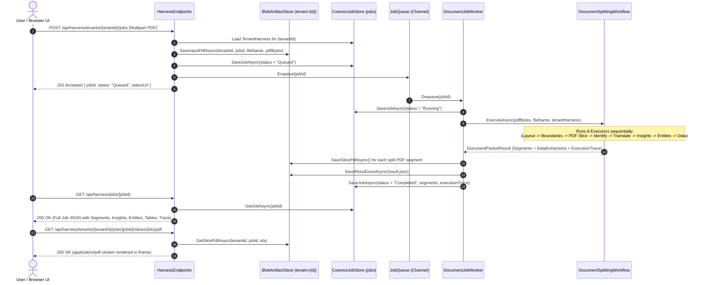

# DocIntel — End-to-End Architecture & Document Processing Guide

This document provides a comprehensive technical walkthrough of **what** happens and **how** a document packet is processed end-to-end in **DocIntel**—from PDF upload and per-tenant Agent Harness loading to deterministic PDF slicing, AI document identification, translation, insight generation, entity extraction, and schema-driven structured data extraction.

---

## Ask AI execution policy

Ask AI requires a configured, non-simulated model endpoint. It does not inherit the legacy
document-processing simulator or cross-provider fallback: missing configuration, invalid model
output, provider errors, and cancellation must not be converted into successful document answers.
Tests inject scripted model clients; they do not require a cloud deployment. The tenant must be
active with the `AskAi` capability enabled.

The conversational loop uses `FunctionInvokingChatClient` with `search_documents` and
`inspect_document_slice`. Search accepts a typed plan, not model-generated SQL: the server binds
tenant, status, text, document type, and ANDed entity conditions as Cosmos parameters and queries
only that tenant partition. Results are lightweight pages of at most 20 references; no-match and
storage errors never expand to all documents. Slice inspection returns bounded original text,
insights, entities, structured data, and matching prompt-column results. Tenant configuration and
active prompt-column definitions are provided to the model as context.

Evidence IDs, file names, page ranges, and links come from inspected stored slices. Final document
answers must cite those IDs, and inline citation numbering is checked. Greetings, clarifications,
and no-evidence responses can have no citations. This validates source identity and numbering, not
the factual entailment of every generated sentence or OCR bounding-box accuracy. Per-run limits
are 12 model iterations and 24 tool calls, including registered extension tools; source chunks are
at most 3,000 characters. Providers must support native function calling and structured responses;
the existing text-only Foundry Inference adapter is explicitly unsupported for Ask AI.

Email HTML and Teams cards are formatted payloads, not delivered integrations. Request-supplied
callback URLs are rejected until an approved destination policy exists. The current run store and
queue remain process-local: durable scheduling, identity/resource authorization, and Microsoft 365
delivery are separate prerequisites before production rollout.

## 1. High-Level System Architecture

**DocIntel** is built on **.NET 10**, **.NET Aspire** (`DocIntel.AppHost` + `DocIntel.ServiceDefaults`), and the **Microsoft Agent Framework** (`Microsoft.Agents.AI` + `Microsoft.Agents.AI.Workflows`).

```mermaid
flowchart TB
    subgraph Client["Unified Web UI (wwwroot/index.html)"]
        UI_Results["Document Intelligence Workspace<br/>(Insights · View Document · Entities · Structured Data · Metadata)"]
        UI_Harness["Agent Harness Studio<br/>(Models + 6 Capability Configurations per Tenant)"]
    end

    subgraph API["DocIntel.Api (ASP.NET Core Minimal APIs + Background Worker)"]
        Endpoints["HarnessEndpoints.cs<br/>(/api/harness/tenants, /jobs, /slices/{idx}/pdf)"]
        Queue["Channel&lt;string&gt; Async Job Queue"]
        Worker["DocumentJobWorker (BackgroundService)"]
    end

    subgraph Workflow["Microsoft.Agents.AI.Workflows Pipeline (DocumentSplittingWorkflow)"]
        E1["1. ExtractPageLayoutsExecutor<br/>(PdfPig Geometry & Footer Extraction)"]
        E2["2. DetectSliceBoundariesExecutor<br/>(100% Deterministic Boundary & Cover-Page Backfill)"]
        E3["3. WritePdfSlicesExecutor<br/>(PdfSharpCore Byte-Level PDF Slicing)"]
        E4["4. IdentifyDocumentsExecutor<br/>(Decision Model Rule Matching)"]
        E5["5. TranslateDocumentsExecutor<br/>(Azure AI Translator + Glossary Protection)"]
        E6["6. GenerateDocumentInsightsExecutor<br/>(Language Model Executive Summaries)"]
        E7["7. ExtractEntitiesExecutor<br/>(Prompt-Guided Named Entity Extraction)"]
        E8["8. ExtractDocumentDataExecutor<br/>(Per-Document-Type Fields & Tables)"]
        E1 --> E2 --> E3 --> E4 --> E5 --> E6 --> E7 --> E8
    end

    subgraph Storage["Azure Persistence & AI Services (Managed Identity RBAC)"]
        CosmosH[("Cosmos DB: harnesses<br/>PK: /tenantId")]
        CosmosJ[("Cosmos DB: jobs<br/>PK: /tenantId")]
        Blob[("Azure Blob Storage<br/>Container: tenant-{tenantId}")]
        Foundry["Microsoft Foundry (AIServices)<br/>gpt-5-mini + Decision Model + AI Translator"]
    end

    UI_Harness -->|PUT /api/harness/tenants/{id}| Endpoints
    UI_Results -->|POST /api/harness/tenants/{id}/jobs| Endpoints
    Endpoints -->|Read/Write Harness| CosmosH
    Endpoints -->|Enqueue JobId| Queue
    Queue --> Worker
    Worker -->|Execute Directed Graph| Workflow
    E3 -->|Upload Split PDFs| Blob
    E4 & E6 & E7 & E8 -->|IChatClient Inference| Foundry
    E5 -->|Translation API| Foundry
    Worker -->|Persist Job & Trace| CosmosJ
    UI_Results -->|Poll Job & Stream Slice PDFs| Endpoints
```

---

## 2. Multi-Tenant Governance Model (`TenantHarness`)

Every tenant (for example, `contoso-legal` or `fabrikam-procurement`) has a versioned **`TenantHarness`** stored in the `harnesses` Cosmos DB container (partitioned by `/tenantId`).

When a document is submitted for a tenant, the workflow reads the tenant's active `TenantHarness` snapshot, which governs **two model tiers** and **six toggleable capabilities**:

| Layer | Setting | Purpose |
|---|---|---|
| **Decision Model** | `DecisionModelId` (`decision-1`) | High-speed, deterministic classification model used in **Stage 4 (`IdentifyDocumentsExecutor`)** to match each PDF slice against admin-defined document rules. |
| **Language Model** | `DefaultModelId` (`gpt-5-mini`, `gpt-4o`, `deepseek-r1`, etc.) | Generative reasoning model used for **Document Insights**, **Entity Extraction**, and **Structured Data Extraction**. |
| **Capability 1** | `DocumentSplitting` (`Enabled`) | Controls whether multi-document PDF packets are split into logical sub-documents or processed as a single document. |
| **Capability 2** | `DocumentIdentification` (`Enabled`, `Rules[]`) | List of `(DocumentName, IdentificationPrompt)` rules evaluated per slice. |
| **Capability 3** | `DocumentTranslation` (`Enabled`, `TargetLanguage`, `AutoDetectSourceLanguage`, `DoNotTranslateTerms[]`) | Translates non-target-language slices while preserving protected legal/product terms. |
| **Capability 4** | `DocumentInsight` (`Enabled`, `InsightInstructions`) | Custom prompt instructions governing how executive summaries are written for each slice. |
| **Capability 5** | `EntityExtraction` (`Enabled`, `ExtractionPrompt`) | Custom instructions governing which entities (`Customer Name`, `Contract Number`, `Total Deal Value`, etc.) are extracted. |
| **Capability 6** | `DataExtraction` (`Enabled`, `Schemas[]`) | Per-document-type schema definitions containing **Key-Value Fields** (`FieldName`, `Instruction`) and **Tables** (`TableName`, `Instruction`, `Columns[]`). |

---

## 3. End-to-End Request & Async Job Lifecycle



---

## 4. Deep-Dive: The 8-Executor Workflow Pipeline

`DocumentSplittingWorkflow` orchestrates an 8-step directed graph built on `Microsoft.Agents.AI.Workflows` (`WorkflowBuilder` + `InProcessExecution.RunAsync`). Every executor records its latency, model used, and diagnostic notes into `WorkflowExecutionTrace`.

### Step 1: `ExtractPageLayoutsExecutor` (Deterministic Geometry & Footer Extraction)
- **What it does**: Parses the raw PDF byte array using `UglyToad.PdfPig` (`PdfPigLayoutExtractor`) without calling any LLM.
- **How it works**:
  1. Iterates through every page (`1..N`) and reads page geometry (`Width`, `Height`, and orientation: Portrait vs. Landscape).
  2. Groups words into horizontal text lines by clustering words whose baseline $Y$-coordinates are within `3.5 pt`.
  3. **Bottom-10% Footer Zone Extraction**: Any line positioned in the bottom 10% of page height ($Y \le 0.10 \times \text{PageHeight}$) is captured as a candidate footer line.
  4. **Sub-Document Pagination Parsing**: Applies a compiled regex (`(?:Page|Pg\.?|Página|Seite|Pág\.?)\s*(\d{1,3})\s*(?:of|de|von|/)\s*(\d{1,3})`) to extract `(SubPageNumber, SubTotalPages)` (e.g., `"Page 1 of 3"` $\rightarrow (1, 3)$).
  5. **Footer Template Normalization**: Strips page numbers, dates, and volatile digits from the raw footer text to compute a canonical **Footer Template Signature** (e.g., `x20-12661-01-cps-es` or `Form-MBSA-v1`) alongside a lightweight language detector (`en`, `es`, `de`, `fr`).

---

### Step 2: `DetectSliceBoundariesExecutor` (100% Deterministic Multi-Signal Slicing)
- **What it does**: Groups contiguous pages into logical sub-document slices (`DocumentSegment`) using physical layout, pagination resets, cover-page backfill, and fuzzy OCR footer clustering—with **zero LLM calls**.
- **How it works** (`SliceBoundaryAnalyzer.DetectBoundaries`):
  - **If `DocumentSplitting.Enabled == false`**: Keeps all pages (`1..N`) as a single slice (`SingleDocumentMode`).
  - **If `DocumentSplitting.Enabled == true`**: Evaluates four deterministic signals in priority order:
    1. **Cover-Page Lookahead Backfill (Signal A)**:
       Many enterprise contracts (such as a Customer Price Sheet following a 3-page Signature Form) have a **cover page with no footer** on Page $P$, followed by `"Page 2 of 6"` on Page $P+1$.
       Before scanning Page $P+1$, the analyzer checks if Page $P$ had no `SubPageNumber`, Page $P+1$ has `SubPageNumber == 2`, and either:
       - Page $P-1$ reached the end of its previous document (`SubPageNumber == SubTotalPages`, e.g., `3 of 3`), **or**
       - Page $P$ changed physical page dimensions/orientation compared to Page $P-1$ (e.g., Portrait $612\times792$ $\rightarrow$ Landscape $792\times612$).
       When true, a split boundary is placed **before Page $P$** so the cover page stays attached to Pages $P+1..P+5$.
    2. **Explicit Sub-Page Reset (Signal B)**:
       If Page $P$ has `SubPageNumber == 1` (and Page $P > 1$), a new slice starts at Page $P$.
    3. **Previous Document Completed (Signal C)**:
       If Page $P-1$ explicitly ended its pagination (`SubPageNumber == SubTotalPages`, e.g., `Page 3 of 3`), Page $P$ starts a new slice.
    4. **Pagination Total Mismatch or Fuzzy Footer Template Change (Signal D)**:
       - If both pages declare `SubTotalPages` and they differ (e.g., `of 3` vs. `of 6`), a split occurs.
       - Otherwise, the analyzer compares the normalized **Footer Template Signatures** using **Levenshtein similarity** ($\ge 0.72$ threshold). This prevents false splits when OCR slightly garbles a footer on one page (e.g., `x20-12661` vs `x2O-12661`), while cleanly splitting when the form code genuinely changes (e.g., `Form-MBSA-v1` $\rightarrow$ `Form-EA-v2`).

---

### Step 3: `WritePdfSlicesExecutor` (Byte-Level PDF Slicing)
- **What it does**: Physically splits the original PDF into standalone, valid PDF files—one per detected `DocumentSegment`.
- **How it works**:
  - Opens the source PDF stream with `PdfSharpCore.Pdf.IO.PdfReader` (`PdfDocumentOpenMode.Import`).
  - For each slice (`StartPage..EndPage`), creates a new `PdfDocument`, copies only the pages belonging to that slice, and serializes the resulting PDF bytes into `segment.SplitPdfBytes`.
  - When `DocumentJobWorker` finishes workflow execution, each slice's `SplitPdfBytes` is uploaded to the tenant's isolated Azure Blob container (`tenant-{tenantId}/{jobId}/slices/slice-{index}-pages-{start}-{end}.pdf`) and served via `GET /api/harness/tenants/{tenantId}/jobs/{jobId}/slices/{sliceIndex}/pdf`.

---

### Step 4: `IdentifyDocumentsExecutor` (Decision Model Classification)
- **What it does**: Classifies each PDF slice into one of the tenant's admin-defined document types or **`"Undefined"`**.
- **How it works**:
  - Checks `harness.DocumentIdentification.Enabled`. If disabled or no rules exist, labels every slice `"Undefined"`.
  - Otherwise, resolves the tenant's **Decision Model** (`harness.DecisionModelId`, e.g., `decision-1`) via `IModelCatalog`.
  - Sends a structured classification prompt containing:
    - The tenant's configured `(DocumentName, IdentificationPrompt)` rules.
    - The slice's page range, footer signatures, and first `2,500` characters of extracted text.
  - Parses the JSON response (`documentName`, `matchedRule`, `confidence`). Only document names that match a defined rule (case-insensitive) are accepted; any non-matching or low-confidence slice is safely marked **`"Undefined"`**.

---

### Step 5: `TranslateDocumentsExecutor` (PDF Document Translation via `SingleDocumentTranslationClient`)
- **What it does**: Translates any PDF slice (`slice.SplitPdfBytes`, `application/pdf`) whose detected language differs from `harness.DocumentTranslation.TargetLanguage` (for example, Spanish `es` $\rightarrow$ English `en`) into a **translated PDF document (`slice.TranslatedPdfBytes`)** while preserving the original PDF layout, tables, and formatting.
- **How it works**:
  - Uses **Azure AI Document Translation** (`Azure.AI.Translation.Document.SingleDocumentTranslationClient` for synchronous PDF-in $\rightarrow$ PDF-out translation and `DocumentTranslationClient` for batch Blob-to-Blob translation)—**not** raw text translation.
  - Builds a `MultipartFormFileData` containing `slice.SplitPdfBytes` (`application/pdf`) and dynamically generates a TSV glossary (`donottranslate.tsv`, `text/tab-separated-values`) from `harness.DocumentTranslation.DoNotTranslateTerms` (e.g., `MBSA\tMBSA`, `Azure\tAzure`, `Contoso\tContoso`).
  - Invokes `SingleDocumentTranslationClient.DocumentTranslateAsync(targetLanguage, translateContent, sourceLanguage: detectedLang)` to receive the translated PDF binary (`TranslatedPdfBytes`), saves it to the tenant's Blob container (`{jobId}/slices/slice-{i}-translated.pdf`), and extracts `TranslatedText` from the translated PDF via `PdfPig` so downstream executors (Insights, Entities, Structured Data) operate on the translated document.
  - In the UI (`View Document`), users can toggle directly between the **Translated PDF** and the **Original PDF**.

---

### Step 6: `GenerateDocumentInsightsExecutor` (Executive Summary Generation)
- **What it does**: Generates a concise executive summary for each slice and an overall packet summary.
- **How it works**:
  - Checks `harness.DocumentInsight.Enabled`.
  - Resolves the tenant's **Language Model** (`harness.DefaultModelId`, e.g., `gpt-5-mini`).
  - Prompts the model with the admin's `InsightInstructions` (`"Summarize key commercial terms, effective dates, pricing commitments, and anomalies..."`) and the slice's text (`TranslatedText ?? BodyText`).
  - Populates `segment.InsightSummary` and `state.DocumentInsightSummary`.

---

### Step 7: `ExtractEntitiesExecutor` (Prompt-Guided Entity Extraction)
- **What it does**: Extracts structured named entities (`ExtractedEntityItem`: `Name`, `Value`, `Category`, `Confidence`, `PageNumber`) from each slice.
- **How it works**:
  - Checks `harness.EntityExtraction.Enabled`.
  - Uses the tenant's `ExtractionPrompt` and **Language Model** (`gpt-5-mini`) to extract entities in strict JSON format, with deterministic regex fallback (`ExtractHeuristicEntities`) for common commercial identifiers (`MBA/MBSA Number`, `Customer Name`, `Tenant ID`, `Quote Number`, `Currency`, `Total Deal Value`, `Effective Date`).

---

### Step 8: `ExtractDocumentDataExecutor` (Schema-Driven Key-Value & Table Extraction)
- **What it does**: Extracts structured **Key-Value Pairs** and multi-column **Tables** tailored to the slice's identified document type.
- **How it works**:
  - Checks `harness.DataExtraction.Enabled`.
  - Looks up the `DocumentTypeExtractionSchema` in `harness.DataExtraction.Schemas` whose `DocumentName` matches `segment.IdentifiedDocumentName` (determined in Step 4).
  - If a matching schema exists (for example, `Customer Price Sheet` with fields `Customer Name`, `Agreement Number`, `Currency` and table `Pricing Line Items` with columns `Item / SKU`, `Quantity`, `Net Price`), it prompts the Language Model with the exact field instructions and table column instructions.
  - Populates `segment.DataExtraction` (`Fields[]` + `Tables[]`), which renders in the **Structured Data** tab of the UI.

---

## 5. Multi-Tenant Data Storage & Security Architecture

| Resource | Container / Scope | Partition Key / Isolation | Purpose |
|---|---|---|---|
| **Azure Cosmos DB (`DocIntel`)** | `harnesses` | `/tenantId` | Stores the active and versioned `TenantHarness` configuration per tenant. |
| **Azure Cosmos DB (`DocIntel`)** | `jobs` | `/tenantId` | Stores `DocumentJobRecord` documents (status, segment metadata, insights, entities, structured data, and `executionTrace`). |
| **Azure Blob Storage** | `tenant-{tenantId}` | Dedicated container per tenant | Stores raw input PDFs (`{jobId}/input/...`), split slice PDFs (`{jobId}/slices/slice-{i}.pdf`), and `result.json`. |
| **Microsoft Foundry (`AIServices`)** | Model Deployments & Translator | User-Assigned Managed Identity | Hosts `gpt-5-mini` and Azure AI Translator accessed via keyless `DefaultAzureCredential`. |
